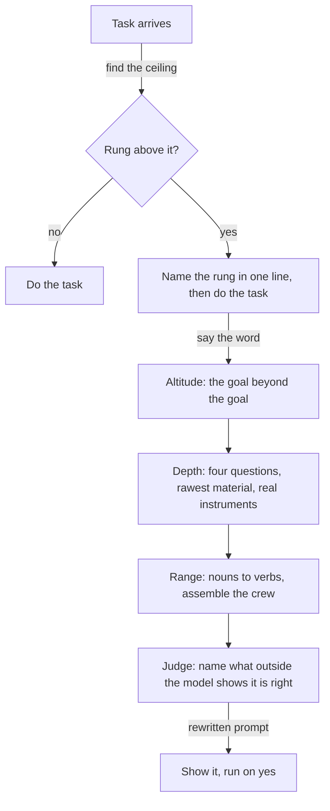

# Higher Power

A Claude Code skill that finds the ceiling in a task and names the rung above it, in one line, before the work starts.

Based on Felix Rieseberg's post [How to be more ambitious: A tutorial for humans with models](https://felixrieseberg.com/how-to-be-more-ambitious-a-tutorial-for-humans-with-models/). The four altitudes, the depth questions, and the stories are his.

## Install

```bash
git clone https://github.com/b1rdmania/higher-power ~/.claude/skills/higher-power
```

## Usage

The skill fires on the shape of the task, not on a command. Give Claude Code a task that is outcome-shaped, meeting-shaped, or sits on raw material it has not seen. Before it executes, it says one line:

```
Higher rung: keep the apps crash-free, not fix this crash. Say the word.
```

Then it does the task as asked. Say the word and it climbs. Say nothing and it continues.

Explicit triggers also work:

```
higher power
be more ambitious
what should I be asking for
```

## What it does



- Names one higher rung per thread, in one line, then proceeds as asked
- On "say the word", climbs Altitude, Depth, and Range and writes the prompt that asks for exactly that
- Requires an outside judge for the result. If none exists, it says so instead of inventing one
- Uses the methods of a field, not the voice. It researches like a short seller; it does not write like one

## What it does not do

- Does not offer speed as a rung. Faster is not more ambitious
- Does not climb on creative work where the asked thing is the thing
- Does not fire after the user writes "bro"
- Does not offer a second rung in a thread after the first was declined

## Always-on line

The skill description makes Claude Code load it when the task fits. To make the check run on every task, add this to `~/.claude/CLAUDE.md`:

```markdown
## Higher Power
Before executing a task that is outcome-shaped, meeting-shaped, or sits on raw material I have not seen, find the ceiling in the ask. If there is a rung above it, name it in one line ("Higher rung: X. Say the word.") and then do the task as asked. Once per thread; never after "bro"; never for creative work. The skill `higher-power` has the full method for when the word is said.
```

## Requirements

Claude Code. No MCP servers, keys, or binaries.

## License

MIT
